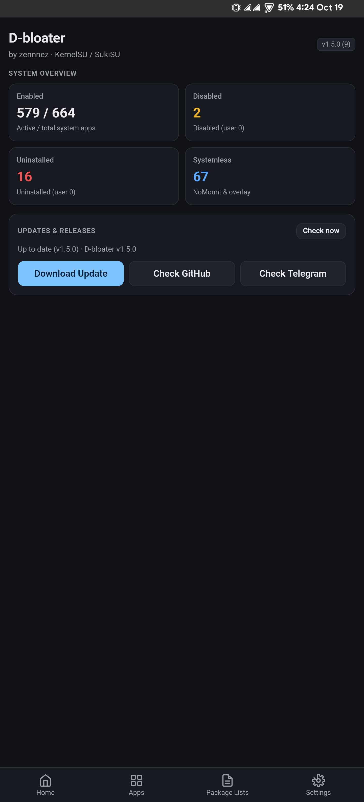
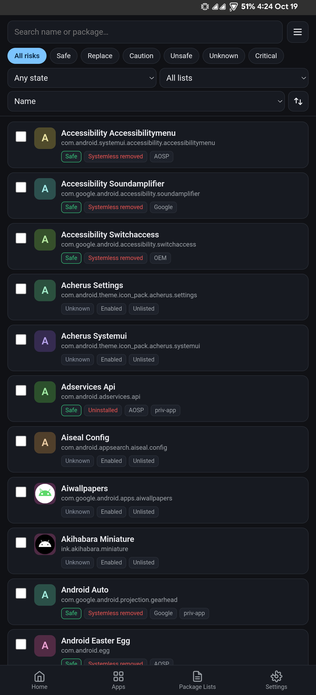
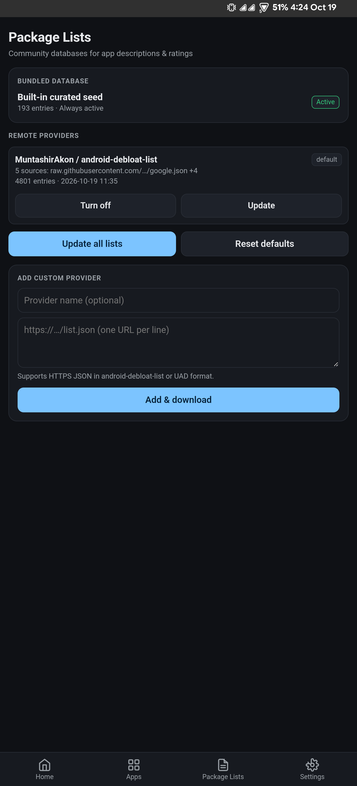
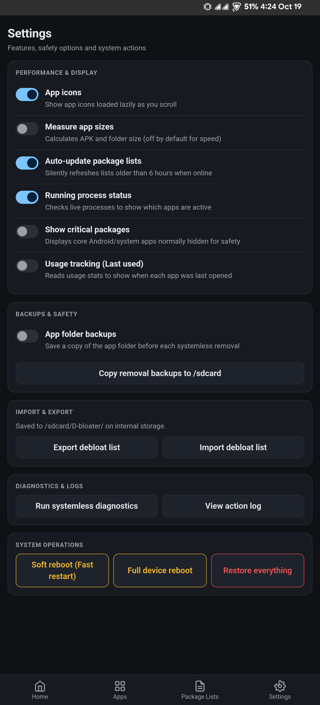

# D-bloater

[](../../releases/latest)
[](#requirements)
[](https://t.me/kokernel)

A root-based WebUI debloater for **KernelSU**, **APatch**, and **SukiSU**. Categorizes system apps with community **risk ratings**, highlights **dependencies**, and lets you debloat with one-tap reversible methods.

Author: [zennnez](https://github.com/zennnez) · Community: [Telegram](https://t.me/kokernel)

<p align="center">
  
  
  
  
</p>

---

## Features

- **Bottom Navigation**: Fast navigation across **Home**, **Apps**, **Package Lists**, and **Settings**.
- **System Overview**: 2×2 dashboard displaying enabled, disabled, uninstalled (user 0), and systemless counts.
- **Risk Ratings**: Safe, Replace, Caution, Unsafe, Critical, and Unknown ratings for every system package.
- **Three Reversible Actions**:
  - **Disable**: Disables app for user 0 (`pm disable-user`). Instant restore.
  - **Uninstall**: Uninstalls package for user 0 (`pm uninstall -k`). Instant restore.
  - **Systemless Remove**: Hides app via metamodule whiteout rules (NoMount / `.replace`). Reversible upon reboot.
- **Safety Safeguards**: Confirmation modal with dry-run paths, bootloop protection (auto-reverts on 3 failed boots), and critical system package protections.
- **Dependency Graph**: Identifies default apps (launcher, phone, SMS, keyboard), shared UIDs, and overlay dependencies.
- **Backups & Restore**: Back up app directories before systemless removal, restore with one tap, or export/import lists to `/sdcard/D-bloater/`.
- **Search & Sort**: Filter by risk, state, or list provider, with ascending/descending directional sort toggle.
- **Background Updates**: In-app update check with changelog preview and direct download.

---

## Requirements

- Android with root via **KernelSU**, **APatch**, or **SukiSU** supporting WebUI.
- For **Systemless removal**: A metamodule handling whiteouts/overlays (e.g. [NoMount](https://github.com/maxsteeel/nomount) recommended).

---

## Quick Start

1. Download the latest `D-bloater-vX.Y.Z.zip` from [Releases](../../releases/latest).
2. Install the zip in your root manager (KernelSU / APatch / SukiSU) and **reboot**.
3. Open the manager's **Modules** tab and tap **WebUI** on D-bloater.
4. Filter apps, review risk ratings and dependencies, and select your removal method.

---

## Removal Methods

| Action | Mechanism | Undo |
|---|---|---|
| **Disable** | `pm disable-user --user 0` | Re-enable instantly |
| **Uninstall (user 0)** | `pm uninstall -k --user 0` | Reinstall instantly |
| **Systemless remove** | Hides package folder via NoMount whiteout / overlay | Revert and reboot |

*Selections are preserved in `/data/adb/dbloater/` and re-applied after boot to survive OTAs.*

---

## Risk Ratings

| Rating | Meaning |
|---|---|
| **Safe** | Verified safe to remove without breaking functionality. |
| **Replace** | Safe to remove once an alternative is installed (e.g., keyboard, browser). |
| **Caution** | May break specific secondary features. Check dependencies first. |
| **Unsafe** | Core dependency that can cause bootloops or instability. Requires extra confirmation. |
| **Critical** | Protected OS components. Only disable is permitted; uninstall is blocked. |
| **Unknown** | Unlisted package. Prefer Disable first. |

---

## CLI Reference

The WebUI interacts directly with `bin/dbl.sh`. You can execute commands from a root shell:

```sh
su -c "sh /data/adb/modules/dbloater/bin/dbl.sh <command> [args...]"
```

| Command | Action |
|---|---|
| `scan` | Scan installed packages and current debloat states |
| `info` | Read APK sizes and running processes |
| `disable` / `enable` | Disable / re-enable package for user 0 |
| `uninstall` / `restore` | Uninstall / restore package for user 0 |
| `sysrm` / `sysunrm` | Queue / cancel systemless removal |
| `plan <pkg>` | Dry run showing target partition and mount strategy |
| `softreboot` | Restart framework to apply pending NoMount rules |
| `restoreall` | Restore all debloated packages to original state |
| `diag` | Diagnose systemless overlay and metamodule status |
| `backup` / `delbackup` | Copy removal backups to `/sdcard` / delete an archive |

---

## Community & Updates

- **Telegram**: Join [KernelSU / SukiSU](https://t.me/kokernel) for discussions, feedback, and support.
- **Releases**: Check [GitHub Releases](../../releases) or use the **Check now** button on the Home tab.
- **Changelog**: See [CHANGELOG.md](CHANGELOG.md).

---

## Disclaimer

Use at your own risk. The author is not responsible for data loss or device bootloops. Always back up your device before debloating system components.
